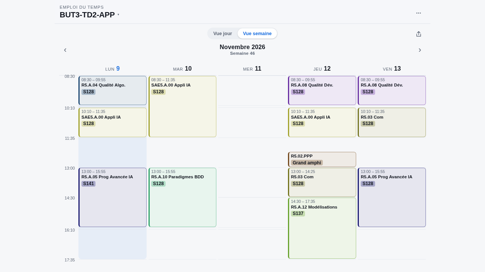
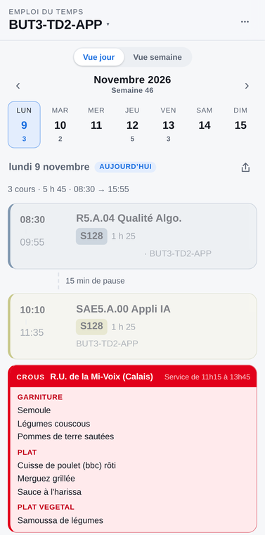
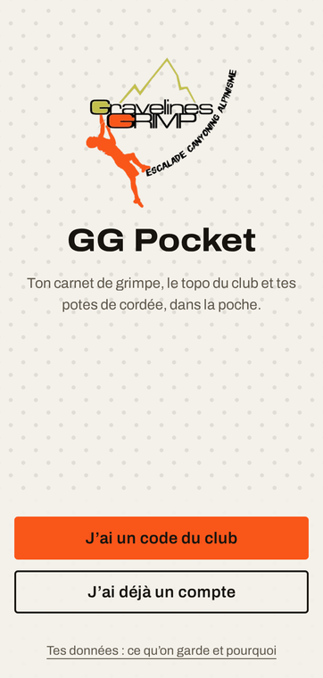
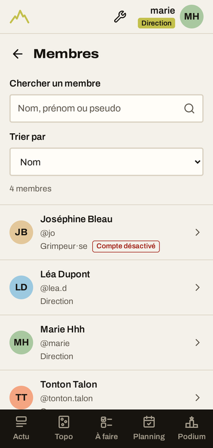
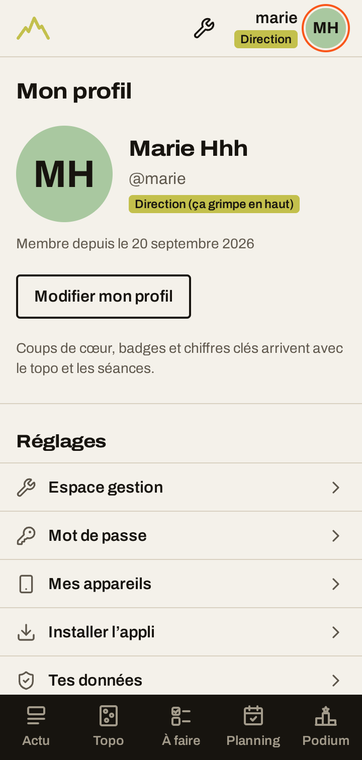

### Willem — développeur full-stack

Alternant développeur Java chez **TGI Maritime Solutions** (Dunkerque) et étudiant en 3ᵉ année de **BUT Informatique**, parcours développement d'applications, à l'ULCO (Calais).

Je construis des applications de bout en bout, du schéma de base de données jusqu'au `docker-compose.yml` qui tourne en production, et j'auto-héberge tout ce que je peux : homelab sous Ubuntu Server avec Docker, Tailscale, Pi-hole, Immich et n8n. La plupart de mes projets répondent à un besoin concret de mon entourage : étudiants, club d'escalade, enseignants.

> **Je recherche** un cycle ingénieur en alternance à partir de **septembre 2027**, idéalement autour de Lille, orienté **DevOps et sécurité applicative**.

  
  

#### Stack

  
  
  
  
  
  
  
  
  
  
  
  
  
  

---

#### Projets

**[EDT ULCO](https://github.com/Whiplashhhh/EDT)** · [edt-ulco.fr](https://edt-ulco.fr/)

Consultation de l'emploi du temps de l'ULCO, rapide et lisible sur mobile, sans passer par ADE. Hébergé sur un VPS derrière un tunnel Cloudflare, utilisé chaque jour par les étudiants.

  
  

  
  
  

**[GG Pocket](https://github.com/Whiplashhhh/GG_Pocket)** · v1.0 en approche

PWA mobile pour le club d'escalade Gravelines Grimp (50 à 200 adhérents), qui remplace une application générique peu utilisée. Projet bénévole avec un vrai cycle de livraison : branches de fonctionnalité, CI, pull requests, environnement de dev, puis releases versionnées en production avec notes de version intégrées à l'application.

  
  
  

  
  
  
  

---

#### Activité

  

  

